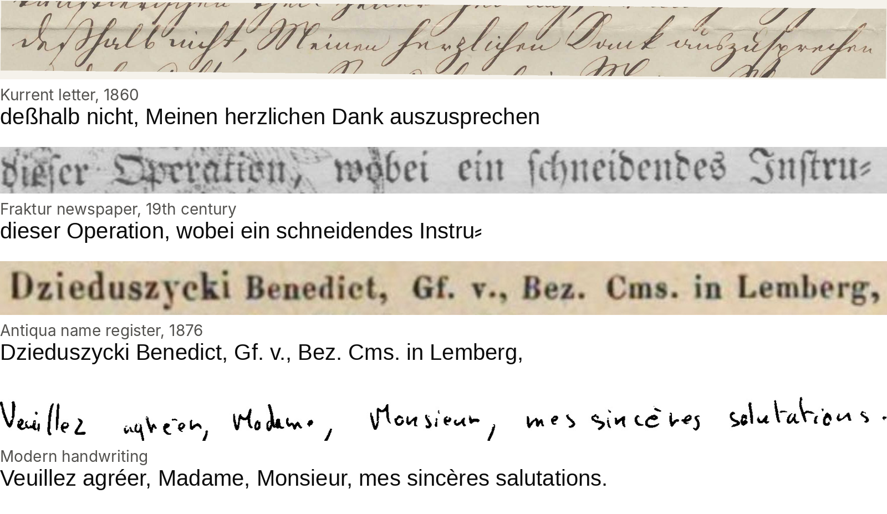
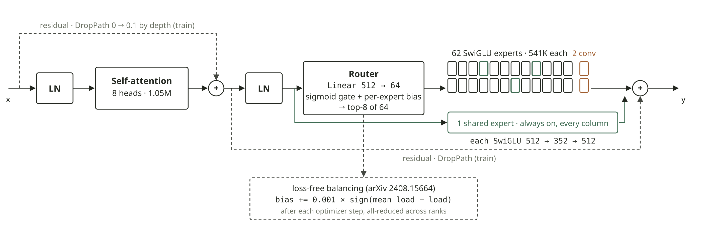
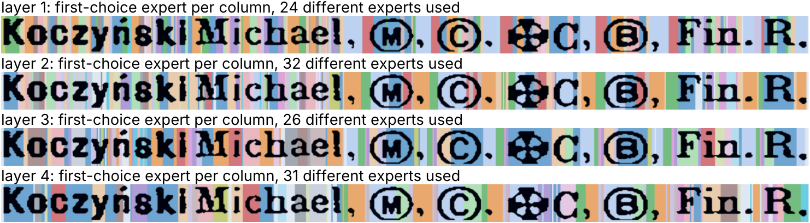
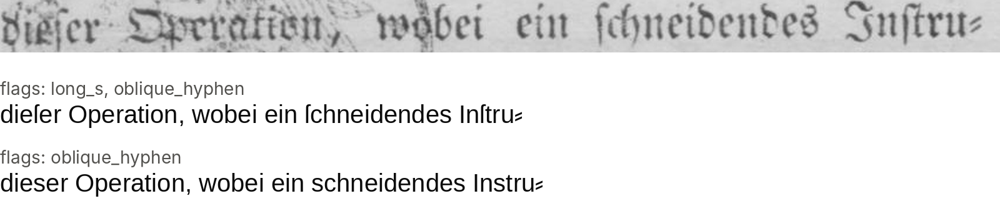
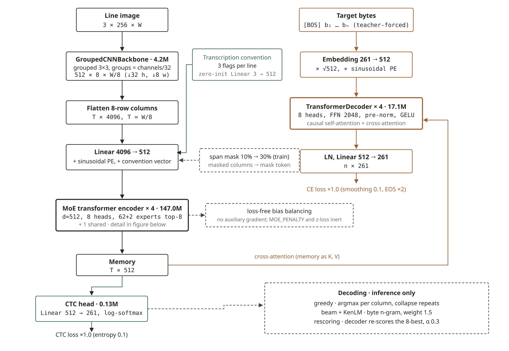

# DeepOCR

One model that reads historical print and handwriting line by line: Fraktur, Antiqua, Kurrent, medieval and modern Latin script, in one checkpoint, with the transcription convention chosen at inference.

  



Output of a development checkpoint on four lines it was not trained on: a Kurrent letter from 1860, a Fraktur newspaper, an Antiqua name register from 1876, and modern handwriting. All four match the human transcription.

## Quickstart

```bash
pip install -r requirements-inference.txt huggingface_hub
hf download M2key1/deepocr-v3 --local-dir weights
```

```python
from pathlib import Path
import torch
from PIL import Image
import infer
from infer import load_model, transcribe_beam

infer.KENLM_PATH = Path('weights/union_bytes_v3.bin')
infer.LM_DICT_PATH = Path('weights/union_bytes_v3.dict')
infer.LM_WEIGHT = 1.0

device = torch.device('cuda' if torch.cuda.is_available() else 'cpu')
model, tokenizer = load_model('weights/deepocr-v3.pt', device)
print(transcribe_beam(model, tokenizer, [Image.open('line.png')], device)[0])

infer.CONVENTION = {'long_s': 1.0, 'oblique_hyphen': 1.0}   # diplomatic: ſ and ⸗ instead of s and -
print(transcribe_beam(model, tokenizer, [Image.open('line.png')], device)[0])
```

## Fine-tuning on your own lines

1. Put line images with their transcriptions in two folders:

   ```
   mydata/
     train/<stem>.png  <stem>.txt
     valid/<stem>.png  <stem>.txt
   ```

2. Download the model (see Quickstart) and train from it:

   ```bash
   TRAIN_SNAPSHOT=mydata TRAIN_BASE_CHECKPOINT=weights/deepocr-v3.pt TRAIN_EPOCHS=20 python train.py
   ```

   The run writes `runs/ocr_<timestamp>/best_model.pt`; `runs/latest_run` points at it.
   Multi-GPU: `torchrun --standalone --nproc_per_node=gpu train.py` with the same variables.

3. Decode with v3's language model (the vocabulary is the same), or build one from your text:

   ```bash
   python build_kenlm.py --input mydata/train --out data/lm/mine --checkpoint runs/latest_run/best_model.pt
   ```

4. Read with it as in the Quickstart, loading `runs/latest_run/best_model.pt`.

## How it reads a line

A line keeps its width: 256 px high, up to 6144 px wide, one 512-number feature per 8 px column. During training 10% to 30% of the columns are hidden in 8-column spans while the targets stay complete, so the encoder learns to read a gap from its neighbours.



One of four encoder layers. A router sends every column to 8 of 64 experts, 62 SwiGLU and 2 convolutional, plus one shared expert that always runs. Balance comes from a per-expert bias nudged by 0.001 after each step, with no auxiliary loss. The two convolutional experts are the only ones that see neighbouring columns, 15 of them, about four characters; on Kurrent the router reaches for them mostly in layer 2.



First-choice expert per column on a printed line, one colour per expert, layer by layer. A CTC head reads a byte per column off the result, and a byte-level 6-gram KenLM is fused into the beam search.



The same checkpoint with the long-s flag on and off. Corpora disagree about the long s, the line-break hyphen `⸗` and typographic punctuation, so each line trains with its corpus's three flags and you pick the flags at inference.

## The whole model



170.5M parameters; 8 of 64 experts plus the shared one run per column. Every architecture setting is stored in the checkpoint, so a checkpoint still loads after `train.py`'s constants change.

<details>
<summary><b>Architecture at a glance</b></summary>

| Component | Details |
|---|---|
| Input | RGB line image, height 256, width up to 6144 px (width-bucketed batching) |
| Backbone | `cnn_grouped` (default, 4.2M params, grouped 3x3 blocks, stride 32 in height and 8 in width). `cnn`, `dinov3` and `trocr` are selectable; the last two need `transformers` |
| Encoder | 4 MoE transformer layers, d_model 512, 8 heads. 62 SwiGLU experts plus 2 convolutional ones, top-8 routing, 1 shared expert, loss-free bias balancing, DropPath, span masking during training. |
| Conditioning | Per-line flags for long s, the Fraktur oblique hyphen and typographic punctuation, measured per corpus by `scripts/audit_conventions.py`; `CONVENTION` in `infer.py` picks which convention to emit |
| CTC head | Linear + log-softmax, CTC loss with entropy smoothing |
| Decoder | 4-layer transformer decoder (teacher-forced cross-entropy, label smoothing), optionally initialised from a pretrained character LM |
| Vocabulary | Byte-level: 5 specials + 256 byte values, token id = 5 + byte |
| Decoding | Greedy CTC, CTC beam search with a fused KenLM (torchaudio/flashlight), optional n-best rescoring with the decoder |

</details>

<details>
<summary><b>Installation</b></summary>

Python 3.12 is recommended. PyTorch wheels come from the CUDA 13.0 index by default; edit the first lines of `requirements.txt` for another CUDA version or CPU-only use.

```bash
python -m venv .venv && source .venv/bin/activate
pip install -r requirements.txt
```

`requirements-inference.txt` is the minimal set for `infer.py`. Building language models also needs the KenLM binaries `lmplz` and `build_binary`, which no pip package ships. On Debian or Ubuntu:

```bash
sudo apt install build-essential cmake libboost-program-options-dev libboost-thread-dev \
    zlib1g-dev libbz2-dev liblzma-dev
git clone https://github.com/kpu/kenlm
cmake -S kenlm -B kenlm/build -DCMAKE_BUILD_TYPE=Release
cmake --build kenlm/build -j8 --target lmplz build_binary
```

Put `kenlm/build/bin` on `PATH` or pass it to `build_kenlm.py --kenlm-bin`. With Boost 1.69 or newer, cmake stops at `Could not find boost_system`; remove `system` and `unit_test_framework` from the Boost `COMPONENTS` list in `kenlm/CMakeLists.txt`.

Copy `.env.example` to `.env` if you use the Label Studio export in `utils/prepare_data.py`.

</details>

<details>
<summary><b>Data</b></summary>

Training data is a flat directory of line images with a transcription next to each image:

```
data/
  train/
    <stem>.png
    <stem>.gt.txt        # or <stem>.txt
  valid/
  split_manifest.json    # which source each pair came from
  lm/                    # KenLM artifacts (see below)
```

`utils/prepare_data.py` builds this layout from raw sources under `data_sources/`. Edit the `root_dirs` list in its `__main__` block, and `DATASET_SOURCES` in `train.py` to match, then run:

```bash
python utils/prepare_data.py
```

It discovers image/text pairs (`.gt.txt`, `.txt`, and PAGE or ALTO XML pages, which are cropped to lines), keeps single-line ground truth, canonicalises the text, deduplicates by image hash and writes a stratified 90/10 split. Images are hardlinked. Set `PREP_DEDUPE=0` to skip the hash pass when the sources have not changed.

Then run `python scripts/audit_conventions.py` to measure which corpora transcribe diplomatically. It writes `data/conventions.json`, which `train.py` reads; without it the conditioning is off and every corpus trains as normalized.

Datasets, checkpoints and language models are not part of this repository.

</details>

<details>
<summary><b>Training</b></summary>

All hyperparameters are module-level constants at the top of `train.py`. Runtime overrides that do not require editing the file:

| Variable | Effect |
|---|---|
| `OCR_BATCH` | Per-GPU batch size (learning rates scale with the square root of the effective batch) |
| `OCR_NUM_WORKERS` | Dataloader workers per rank |
| `OCR_RESUME` | `auto`, a run directory or a checkpoint path; restores weights, EMA, optimizer, scheduler and epoch |
| `OCR_LIMIT`, `OCR_VALID_LIMIT` | Cap the number of training / validation samples |
| `TRAIN_BASE_CHECKPOINT` | Warm-start from another run's `best_model.pt`; overrides `PRETRAIN_WEIGHTS`. A checkpoint with a different backbone loads everything except the backbone |
| `TRAIN_<NAME>` | Overrides the constant `NAME` for every name in `APP_TUNABLES` (e.g. `TRAIN_WARMUP_EPOCHS=2`); `TRAIN_LR` sets all three learning rates |

```bash
# single GPU
python train.py

# all GPUs on one node
torchrun --standalone --nproc_per_node=gpu train.py

# SLURM
sbatch train.slurm
```

Each run writes to `runs/ocr_<timestamp>/`: `best_model.pt` (selected on validation CER), a rolling `last_checkpoint.pt` for resume, and TensorBoard logs. `runs/latest_run` points at the newest run.

Validation reports greedy CER/WER every epoch, overall and per source dataset; beam search and decoder rescoring run every `BEAM_VAL_FREQUENCY` / `DECODER_VAL_FREQUENCY` epochs.

</details>

<details>
<summary><b>Language models</b></summary>

**KenLM for beam search.** The LM vocabulary must be index-parallel to the model's token inventory, so build it against the checkpoint it will be used with:

```bash
python build_kenlm.py --input data/train --out data/lm/union --order 6 \
    --checkpoint runs/<run>/best_model.pt
```

This writes `union.bin` and `union.dict`; point `KENLM_PATH` and `LM_DICT_PATH` in `train.py` and `infer.py` at them. Without them decoding runs without an LM. Order 6 is the highest the KenLM inside the flashlight-text wheel loads. Use `--corpus-only` to write the training text and run `lmplz` on another machine.

**Decoder pretraining.** `pretrain_decoder.py` trains the character decoder as a standalone LM on transcriptions; set `PRETRAINED_DECODER_LM` in `train.py` to initialise the decoder from it.

</details>

<details>
<summary><b>Inference</b></summary>

`infer.py` evaluates a checkpoint on `data/valid` and prints greedy and beam+LM CER overall and per dataset. Set `CHECKPOINT_PATH`, `KENLM_PATH` and `LM_WEIGHT` at the top of the file, then:

```bash
python infer.py
```

The same module is the Python API shown in the quickstart. Besides `transcribe_beam`, `transcribe(model, tokenizer, images, device, use_decoder=False)` gives greedy CTC (`use_decoder=True` runs the autoregressive decoder instead) and `transcribe_rescored` lets the decoder re-rank the beam's 8-best.

`inference.ipynb` walks through the same calls and renders per-column confidence, entropy and expert-routing maps.

</details>

<details>
<summary><b>Pretrained model</b></summary>

[DeepOCR v3](https://huggingface.co/M2key1/deepocr-v3) (Apache-2.0): the default architecture, trained from scratch on public datasets of historical print and handwriting, with its own KenLM. 3.0% CER on its validation split with beam search and the LM. To fine-tune it, see "Fine-tuning on your own lines".

</details>

## Citation

Use the "Cite this repository" button on GitHub, or:

```bibtex
@software{fleischhacker_deepocr,
  author = {Fleischhacker, David},
  title  = {DeepOCR},
  year   = {2026},
  url    = {https://github.com/m2key1/DeepOCR}
}
```

## License

See `LICENSE`.
